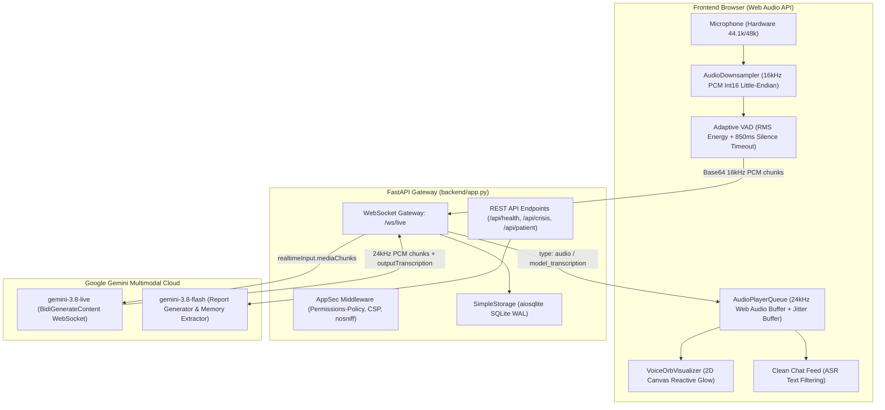
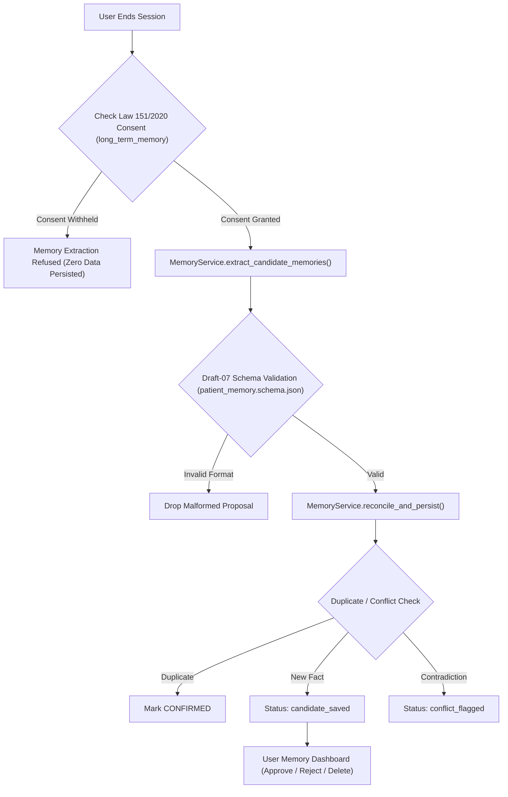

# FADFADA (فضفضة) - Comprehensive AI Psychiatric Agent Pipeline Documentation

> **System Overview**: An AI-powered, voice-first mental health support companion delivering psychiatrist-inspired, empathetic conversations in contemporary Egyptian Colloquial Arabic (العامية المصرية). Powered by Google Gemini Live multimodal bidirectional streaming, structured cognitive protocols, longitudinal memory reconciliation, and Egyptian legal and clinical safety governance.

---

## Table of Contents
1. [End-to-End System Architecture](#1-end-to-end-system-architecture)
2. [AI Models & Allocations](#2-ai-models--allocations)
3. [Real-Time Audio & Streaming Pipeline](#3-real-time-audio--streaming-pipeline)
4. [Prompt Catalog & Specifications (10 Prompts)](#4-prompt-catalog--specifications)
5. [Clinical Knowledge & Evidence-Based Protocols](#5-clinical-knowledge--evidence-based-protocols)
6. [Egyptian Crisis Hotlines & Emergency Safety Protocol](#6-egyptian-crisis-hotlines--emergency-safety-protocol)
7. [Memory Extraction, Reconciliation & Consent Governance](#7-memory-extraction-reconciliation--consent-governance)
8. [Backend Services & Gateway Architecture](#8-backend-services--gateway-architecture)
9. [Frontend Client & Web Audio Implementation](#9-frontend-client--web-audio-implementation)
10. [REST & WebSocket API Contracts](#10-rest--websocket-api-contracts)
11. [Verification, Quality Assurance & Test Matrix](#11-verification-quality-assurance--test-matrix)

---

## 1. End-to-End System Architecture



---

## 2. AI Models & Allocations

The platform utilizes a dual-tier model hierarchy to balance ultra-low latency real-time voice interaction with deep post-session analytical reasoning:

| Layer | Model Identifier | Interface Protocol | Role / Responsibility | Configuration Parameters |
| :--- | :--- | :--- | :--- | :--- |
| **Real-Time Voice Companion** | `gemini-3.8-live` | Bidirectional WebSocket (`BidiGenerateContent`) | Conducts spontaneous, spoken Egyptian Arabic supportive dialogue with natural turn-taking and barge-in handling. | Modality: `["AUDIO"]`<br>Voice: `Aoede` (Warm & Empathetic)<br>Input: 16kHz PCM mono<br>Output: 24kHz PCM mono |
| **Session Analysis & Memory Engine** | `gemini-3.8-flash` | REST JSON Generation | Extracts candidate longitudinal memories, detects contradictions against patient history, and compiles clinical summaries. | Response Schema: Strict JSON<br>Temperature: `0.1` (Deterministic)<br>Safety Settings: Standard Health Strict |

### Voice Personas
The system supports Google Gemini's neural voice personas:
- **`Aoede` (Default & Recommended)**: Warm, calm, thoughtful tone ideally suited for psychiatric de-escalation and emotional validation in Egyptian Arabic.
- **`Puck`**: Conversational, light-hearted tone.
- **`Charon`**: Deep, measured, authoritative tone.
- **`Kore`**: Gentle, soothing tone.
- **`Fenrir`**: Strong, direct tone.

---

## 3. Real-Time Audio & Streaming Pipeline

```
+-------------------------------------------------------------------------------------------------------+
|                                    AUDIO TRANSMISSION TIMELINE                                        |
+-------------------------------------------------------------------------------------------------------+

1. User Speaks
   [ Mic: 48,000 Hz Float32 ] 
              │
              ▼ (AudioDownsampler - Linear Interpolation)
   [ 16,000 Hz Signed 16-Bit Linear PCM, Little-Endian ]
              │
              ▼ (Adaptive VAD & Chunk Framing)
   [ Base64 Chunks: ~3,200 bytes / 100ms per frame ]
              │
              ▼ (WebSocket Uplink: /ws/live)
   {"type": "audio", "data": "..."}
              │
              ▼ (backend/gemini_live.py framing)
   {"realtimeInput": {"mediaChunks": [{"mimeType": "audio/pcm;rate=16000", "data": "..."}]}}
              │
              ▼ (Google Gemini Live API)
   Generative AI Audio Processing & Egyptian Arabic Speech Synthesis

2. User Finishes Speaking
   [ VAD Silence >= 850ms OR User clicks 'خلصت كلامي' ]
              │
              ▼
   {"clientContent": {"turnComplete": true}}

3. Agent Speaks Response
   [ Gemini Live ServerContent Chunk Streams ]
   {"serverContent": {"modelTurn": {"parts": [{"inlineData": {"mimeType": "audio/pcm;rate=24000", "data": "..."}}]}}}
              │
              ▼ (Gateway Demuxing)
   {"type": "audio", "data": "..."} + {"type": "model_transcription", "text": "..."}
              │
              ▼ (Client AudioPlayerQueue)
   [ 24,000 Hz AudioBuffer scheduled on native Web Audio Destination ]
              │
              ▼
   [ Smooth, Click-free Sound Playback + Glowing Visualizer Orb ]
+-------------------------------------------------------------------------------------------------------+
```

### Key Audio Specifications
- **Client Ingestion Rate**: Native hardware sample rate (typically 44.1kHz or 48.0kHz) without downclocking the `AudioContext` to avoid the known Chromium/Windows silence driver bug.
- **Microphone Uplink Rate**: Resampled to exactly `16,000 Hz`, single channel (Mono), signed 16-bit integer PCM, Little-Endian byte order.
- **Audio Chunk Size**: 1,600 samples = 3,200 bytes (~100ms duration per packet).
- **Model Downlink Rate**: `24,000 Hz`, single channel (Mono), signed 16-bit integer PCM, Little-Endian byte order.
- **Jitter Buffer**: Dynamic 30ms scheduling offset to absorb packet transit variance.
- **Voice Activity Detection (VAD)**:
  - Dynamic ambient noise floor tracking: `ambientNoiseFloor = ambientNoiseFloor * 0.95 + rms * 0.05`.
  - Speech threshold: `max(0.012, ambientNoiseFloor * 1.8)`.
  - Turn conclusion silence hangtime: `850ms`.
  - Manual override button: `"خلصت كلامي (رد عليا)"` immediately dispatches turn completion.
- **Barge-in / Interruption Mechanism**:
  - **Manual Interruption**: Clicking `"لحظة / مقاطعة"` sends `user_interrupt` and flushes client audio playback queue immediately.
  - **High-Energy Vocal Interruption**: If RMS exceeds `0.08` for 3 consecutive frames while the agent is speaking, audio playback halts instantly.
  - **Native Server Interruption**: When Gemini Live detects barge-in, it transmits `serverContent.interrupted = true`, which immediately cancels in-flight chunks.

---

## 4. Prompt Catalog & Specifications

All system prompts are managed, versioned, and integrity-verified via SHA-256 in [`prompts/prompt_manager.py`](file:///c:/sharing1/ML4/AI-powered%20psychiatric%20agent/prompts/prompt_manager.py).

```
prompts/
├── clinical/
│   └── therapeutic_protocol_selector.md       (SHA256: 31c7742b97713be7...)
├── evaluation/
│   └── quality_evaluator.md                   (SHA256: 24ba0f93b45b57fa...)
├── live_agent/
│   └── system_prompt.md                       (SHA256: eada2abff6f7a95a...)
├── memory/
│   ├── memory_extractor.md                    (SHA256: 5aa72d9e6dc65a58...)
│   ├── memory_reconciler.md                   (SHA256: 56ce5b68af710771...)
│   └── session_context_builder.md             (SHA256: 5a62eae4e837ab1e...)
├── reporting/
│   ├── detailed_session_report.md             (SHA256: 38bb704a37a20f03...)
│   └── patient_friendly_recap.md              (SHA256: 1f3fe71eaf89272f...)
├── safety/
│   └── safety_signal_analysis.md              (SHA256: d6358094b856cc43...)
└── transcription/
    └── egyptian_arabic_normalizer.md          (SHA256: 9b9a5dfb181ff6bc...)
```

### Detailed Breakdown of Prompts

#### 1. Live Agent Primary Prompt (`live_agent/system_prompt.md`)
- **Key**: `live_agent`
- **Model**: `gemini-3.8-live`
- **Purpose**: Defines the empathetic, culturally grounded conversational psychiatric persona (فضفضة).
- **Core Directives**:
  - Speak natural, contemporary Egyptian Colloquial Arabic (العامية المصرية) exclusively in Arabic script.
  - Sound like an attentive, unhurried human having a supportive conversation—never a robotic assistant or motivational speaker.
  - Ask only **one question at a time**. Allow pauses, silence, and topic shifts.
  - Strict clinical boundary: Explicitly disclose AI nature; **never diagnose**, prescribe medication, or claim to be a licensed clinician.
  - Safety first: On detecting self-harm or danger, cease casual dialogue and transition directly into the Egyptian crisis procedure (16328 / 123).

#### 2. Safety Signal Analysis (`safety/safety_signal_analysis.md`)
- **Key**: `safety_signal`
- **Model**: `gemini-3.8-flash`
- **Purpose**: Real-time analytical component scanning transcripts for suicidal ideation, abuse, intoxication, or severe danger.
- **Contract**: Evaluates urgency and populates [`schemas/safety_signal.schema.json`](file:///c:/sharing1/ML4/AI-powered%20psychiatric%20agent/schemas/safety_signal.schema.json).
- **Clinical Rule**: Distinguishes direct patient statements from vague sadness. Must never assume safety merely because the user changed the topic or smiled.

#### 3. Memory Extractor (`memory/memory_extractor.md`)
- **Key**: `memory_extractor`
- **Model**: `gemini-3.8-flash`
- **Purpose**: Extracts longitudinal candidate facts from completed session turns across 8 approved domains:
  1. `coping_preference`
  2. `communication_preference`
  3. `patient_goal`
  4. `personal_history`
  5. `symptom_report`
  6. `treatment_report`
  7. `support_system`
  8. `boundary`
- **Legal Compliance**: Enforces Egyptian Personal Data Protection Law No. 151/2020. Refuses extraction if `long_term_memory` consent has not been recorded.

#### 4. Memory Reconciler (`memory/memory_reconciler.md`)
- **Key**: `memory_reconciler`
- **Model**: `gemini-3.8-flash`
- **Purpose**: Compares proposed memories against prior verified patient facts to detect duplicates and contradictions.
- **Actions**: `ADD`, `UPDATE`, `CONFIRM`, `FLAG_CONFLICT`, or `DISCARD`.

#### 5. Session Context Builder (`memory/session_context_builder.md`)
- **Key**: `session_context_builder`
- **Model**: Python Service / `gemini-3.8-flash`
- **Purpose**: Compiles a concise, relevant recall package for injection into upcoming live sessions (e.g. *"آخر مرة كنت بتقول إن ضغط الشغل كان تاعبك.. إيه الأخبار دلوقتي؟"*).

#### 6. Therapeutic Protocol Selector (`clinical/therapeutic_protocol_selector.md`)
- **Key**: `therapeutic_protocol_selector`
- **Model**: Clinical Rule Engine / `gemini-3.8-flash`
- **Purpose**: Matches patient symptoms (e.g., acute panic, catastrophizing, bodily tension) to clinician-reviewed protocols in `clinical_knowledge/protocols.json` while honoring contraindications.

#### 7. Detailed Session Report (`reporting/detailed_session_report.md`)
- **Key**: `detailed_session_report`
- **Model**: `gemini-3.8-flash`
- **Purpose**: Compiles comprehensive, evidence-grounded session summaries adhering to [`schemas/session_report.schema.json`](file:///c:/sharing1/ML4/AI-powered%20psychiatric%20agent/schemas/session_report.schema.json).
- **Structure**: Core concerns, emotional timeline, coping strategies attempted, patient response, and unresolved issues.

#### 8. Patient-Friendly Recap (`reporting/patient_friendly_recap.md`)
- **Key**: `patient_friendly_recap`
- **Model**: `gemini-3.8-flash`
- **Purpose**: Translates clinical session reports into warm, accessible Egyptian Arabic text presented directly to the user after concluding the session.

#### 9. Quality Evaluator (`evaluation/quality_evaluator.md`)
- **Key**: `quality_evaluator`
- **Model**: `gemini-3.8-flash`
- **Purpose**: Automated audit harness evaluating dialogue quality across 5 dimensions:
  1. Factual grounding
  2. Clinical boundaries
  3. Egyptian dialect authenticity
  4. Non-judgmental tone
  5. Safety policy compliance

#### 10. Egyptian Arabic Normalizer (`transcription/egyptian_arabic_normalizer.md`)
- **Key**: `egyptian_arabic_normalizer`
- **Model**: `gemini-3.8-flash`
- **Purpose**: Normalizes raw phonetics and removes machine artifacts from ASR transcripts while preserving genuine colloquial vocabulary.

---

## 5. Clinical Knowledge & Evidence-Based Protocols

Interventions are strictly restricted to clinician-reviewed protocols loaded from [`clinical_knowledge/protocols.json`](file:///c:/sharing1/ML4/AI-powered%20psychiatric%20agent/clinical_knowledge/protocols.json):

```json
[
  {
    "id": "grounding_54321",
    "title_ar": "تمرين التثبيت الحسي 5-4-3-2-1",
    "category": "grounding",
    "indications": ["acute_anxiety", "panic_feelings", "feeling_overwhelmed", "dissociation_or_spacing_out"],
    "contraindications": ["active_suicidal_crisis", "severe_psychosis"],
    "evidence_base": "Dialectical Behavior Therapy (DBT) Distress Tolerance",
    "steps_ar": [
      "5 حاجات تقدر تشوفها بعينك دلوقتي.",
      "4 حاجات حواليك وحس ملمسهم.",
      "3 أصوات تقدر تسمعها حواليك.",
      "حاجتين تقدر تشمهم في المكان.",
      "طعم حاجة في لسانك أو رشفة ماية."
    ]
  },
  {
    "id": "box_breathing",
    "title_ar": "تمرين التنفس المربع 4-4-4-4",
    "category": "breathwork",
    "indications": ["bodily_tension", "chest_tightness_emotional", "hyperventilation_rumination"],
    "contraindications": ["acute_medical_respiratory_emergency", "asthma_attack"],
    "evidence_base": "Parasympathetic nervous system activation via paced respiration",
    "steps_ar": [
      "شهيق هادي من الأنف في 4 ثواني.",
      "كتم النفس براحة تامة في 4 ثواني.",
      "زفير بطيء من الفم في 4 ثواني.",
      "انتظار 4 ثواني قبل النفس التالي."
    ]
  },
  {
    "id": "cbt_thought_reframing",
    "title_ar": "فحص الأفكار والتوسيع المعرفي (CBT)",
    "category": "cbt",
    "indications": ["catastrophizing", "all_or_nothing_thinking", "excessive_self_blame"],
    "contraindications": ["acute_grief_immediate_bereavement", "active_crisis"],
    "evidence_base": "Beck Cognitive Behavioral Therapy (CBT)",
    "steps_ar": [
      "تحديد وتسمية الفكرة المقلقة.",
      "فحص الدليل الواقعي المباشر الذي يؤيدها.",
      "البحث عن أدلة أو احتمالات أخرى بديلة.",
      "التفكير فيما كنت ستنصح به صديقاً في نفس الموقف.",
      "صياغة وصف واقعي ومتوازن للموقف."
    ]
  },
  {
    "id": "behavioral_activation_micro",
    "title_ar": "التنشيط السلوكي المصغر (خطوة الـ 5 دقائق)",
    "category": "behavioral_activation",
    "indications": ["apathy_inertia", "low_energy_depression", "task_paralysis"],
    "contraindications": ["severe_exhaustion", "medical_fatigue"],
    "evidence_base": "Behavioral Activation for Depression (Martell et al.)",
    "steps_ar": [
      "اختيار خطوة بالغة الصغر يمكن إنجازها في دقيقتين إلى خمس دقائق.",
      "تقليل متطلبات الإنجاز إلى الحد الأدنى بدون انتظار الرغبة أو الحماس.",
      "ملاحظة الشعور بعد التجربة والاحتفاء بأي تقدم مهما كان بسيطاً."
    ]
  }
]
```

---

## 6. Egyptian Crisis Hotlines & Emergency Safety Protocol

In accordance with Egyptian psychiatric regulations and national data protection mandates, all emergency hotlines are maintained in [`safety_policies/egyptian_crisis_directory.json`](file:///c:/sharing1/ML4/AI-powered%20psychiatric%20agent/safety_policies/egyptian_crisis_directory.json) and displayed continuously in the UI:

| Organization / Service | Phone Number | Availability | Jurisdiction | Official Description |
| :--- | :--- | :--- | :--- | :--- |
| **الأمانة العامة للصحة النفسية (وزارة الصحة)** | **`16328`** | 24/7 مجاناً | مصر (جميع المحافظات) | خدمة استشارات ودعم نفسي مجانية وسرية بإشراف أطباء وأخصائيين نفسيين. |
| **هيئة الإسعاف المصرية** | **`123`** | 24/7 | جمهورية مصر العربية | حالات الطوارئ الطبية العاجلة والإنقاذ والحوادث والتسمم الحاد. |
| **الخط الساخن للاستشارات النفسية (أرضي)** | **`08008880700`** | متاح يومياً | مصر (خطوط أرضية) | المجلس القومي للصحة النفسية للاستشارات المجانية من أي هاتف أرضي. |
| **طوارئ مستشفى العباسية للصحة النفسية** | **`0220816831`** | 24/7 | القاهرة الكبرى | استقبال وتقييم الحالات النفسية الطارئة على مدار 24 ساعة بمحافظة القاهرة. |
| **خط نجدة الطفل (القومي للأمومة والطفولة)** | **`16000`** | 24/7 مجاناً | مصر | حماية الأطفال واليافعين من الإيذاء وتقديم المشورة النفسية والأسرية. |
| **مكتب شكاوى المرأة (القومي للمرأة)** | **`15115`** | 24/7 | مصر | استشارات نفسية واجتماعية وقانونية متخصصة للسيدات والفتيات. |

### Immediate Safety De-escalation Workflow
When severe self-harm ideation or active danger is detected:
1. Normal advice-giving and conversational exploration are immediately suspended.
2. The UI triggers the persistent Egyptian Emergency Modal.
3. The agent recites the approved Egyptian de-escalation message:
   > *"سلامتك وحياتك هي أهم حاجة دلوقتي. أنا صديق ذكاء اصطناعي ومش بديل عن الدعم البشري المتخصص في اللحظات الصعبة دي. أرجوك اتصل فوراً بالخط الساخن للصحة النفسية على رقم 16328 أو اطلب الإسعاف 123، أو اتواصل مع حد قريب منك تثق فيه يكون جنبك دلوقتي."*

---

## 7. Memory Extraction, Reconciliation & Consent Governance

All patient context is isolated and governed in strict adherence to **Egyptian Law No. 151 of 2020 on Personal Data Protection**:



### Supported Memory Domains & Prohibitions
- **Allowed Categories**: `coping_preference`, `communication_preference`, `patient_goal`, `personal_history`, `symptom_report`, `treatment_report`, `support_system`, `boundary`.
- **Absolute Prohibition**: Observations must **never** be converted into clinical or psychiatric diagnoses (e.g., *"Patient has Bipolar Disorder"* is strictly prohibited; *"Patient reported mood swings when stressed"* is permissible).
- **Right to Erasure (شطب البيانات)**: The patient can delete any memory at any time via `DELETE /api/patient/{id}/memories/{memory_id}`.

---

## 8. Backend Services & Gateway Architecture

The backend is built with FastAPI and clean, modular Python services:

```
backend/
├── app.py                      # Main FastAPI application & WebSocket live streaming gateway
├── config.py                   # Environment configuration & audio constants
├── gemini_live.py              # Lightweight Gemini Live BidiGenerateContent protocol client
├── storage.py                  # Lightweight async SQLite storage for sessions & messages
├── run.py                      # Production server entrypoint
└── services/
    ├── gemini_live_bridge.py   # Backward-compatible protocol bridge
    ├── knowledge_service.py    # Clinical protocols & Egyptian crisis directory indexing
    ├── memory_service.py       # Longitudinal memory extraction, reconciliation & erasure
    ├── schema_validator.py     # JSON Schema validation (Draft-07)
    └── storage_service.py      # Multi-table clinical persistence service
```

### Gateway Responsibilities (`backend/app.py`)
1. **WebSocket Streaming Gateway (`/ws/live`)**:
   - Manages asynchronous bidirectionality between client browser and Gemini Live API.
   - Forwards 16kHz PCM audio frames to Gemini Live `realtimeInput`.
   - Sends initial warm welcoming greeting turn upon connection.
   - Demultiplexes incoming 24kHz PCM chunks, model transcriptions, and interruption signals.
2. **AppSec Defense-in-Depth Middleware**:
   - `X-Content-Type-Options: nosniff`
   - `X-Frame-Options: DENY`
   - `X-XSS-Protection: 1; mode=block`
   - `Referrer-Policy: strict-origin-when-cross-origin`
   - `Permissions-Policy: microphone=(self)`

---

## 9. Frontend Client & Web Audio Implementation

The frontend is implemented in vanilla HTML5, modern CSS tokens, and the Web Audio API without bulky UI frameworks:

```
frontend/
├── index.html                  # Serene, accessible UI sanctuary (RTL, Cairo typography)
├── css/
│   └── style.css               # Vanilla CSS design tokens (Emerald/Teal soothing palette)
└── js/
    └── app.js                  # Master client controller & Web Audio streaming engine
```

### Key Frontend Components
1. **Unified AudioContext**:
   - Initializes a single native hardware `AudioContext` without downclocking parameters to prevent hardware driver mute bugs.
2. **AudioDownsampler**:
   - Resamples Float32 audio to 16kHz signed 16-bit PCM in software using linear interpolation and computes real-time RMS for the audio visualizer.
3. **AudioPlayerQueue**:
   - Creates Web Audio `AudioBuffer` objects dynamically for 24kHz audio chunks received from Gemini, maintaining seamless continuity with a 30ms jitter buffer.
4. **VoiceOrbVisualizer**:
   - Canvas-based visualizer with harmonic undulating waves and radial gradients reflecting agent speech energy, user listening state, and interruption cues.
5. **ASR Token Sanitizer**:
   - Strips internal `<thought>` blocks, `<no speech detected>` tags, unclosed brackets, and residual tokens to keep the chat transcript clean and readable.

---

## 10. REST & WebSocket API Contracts

### A. WebSocket Protocol (`/ws/live`)

#### 1. Client to Server
```json
// Initialize session
{
  "type": "init",
  "voice": "Aoede",
  "session_id": "sess_12345678"
}

// Stream 16kHz PCM audio chunk
{
  "type": "audio",
  "data": "BASE64_ENCODED_PCM16_BYTES"
}

// Signal turn completion
{
  "type": "audio_turn_complete"
}

// Fallback typed text turn
{
  "type": "text",
  "text": "حاسس بضغط وتوتر في الشغل"
}

// User barge-in interrupt
{
  "type": "user_interrupt"
}

// Playback state update
{
  "type": "playback_state",
  "is_playing": true
}
```

#### 2. Server to Client
```json
// Ready signal
{
  "type": "ready",
  "session_id": "sess_12345678",
  "voice": "Aoede",
  "audio_spec": {
    "input_sample_rate": 16000,
    "output_sample_rate": 24000
  }
}

// 24kHz PCM audio chunk
{
  "type": "audio",
  "data": "BASE64_ENCODED_24K_PCM"
}

// Live spoken transcription
{
  "type": "model_transcription",
  "text": "أهلاً بيك، أنا سامعك.."
}

// Interruption notice
{
  "type": "interrupted",
  "reason": "gemini_server_interrupted"
}

// Turn complete
{
  "type": "turn_complete"
}
```

### B. Core REST Endpoints

| Method | Path | Description | Response Status |
| :--- | :--- | :--- | :--- |
| `GET` | `/health` / `/api/health` | Service health status and active socket count | `200 OK` |
| `GET` | `/api/info` | Clinical disclaimer, audio specs & primary hotline | `200 OK` |
| `GET` | `/api/protocols` | Catalog of clinician-reviewed coping techniques | `200 OK` |
| `GET` | `/api/crisis` | Verified Egyptian emergency directory & hotlines | `200 OK` |
| `GET` | `/api/patient/{id}` | Patient profile and active consent records | `200 OK` |
| `POST` | `/api/patient/{id}/consent` | Record or update patient consent under Law 151/2020 | `200 OK` |
| `GET` | `/api/session/{id}` | Session metadata and duration details | `200 OK` / `404` |
| `POST` | `/api/session/{id}/extract-memories` | Extract and reconcile longitudinal memories | `200 OK` |
| `GET` | `/api/patient/{id}/memories` | List approved and candidate memories for patient | `200 OK` |
| `POST` | `/api/patient/{id}/memories/{mem_id}/approve` | Patient approval of candidate memory | `200 OK` |
| `DELETE` | `/api/patient/{id}/memories/{mem_id}` | Right to Erasure: permanent deletion of memory | `200 OK` |

---

## 11. Verification, Quality Assurance & Test Matrix

The platform is backed by **82 automated tests** covering every layer of the system:

```
Test Module                                 Tests  Status
------------------------------------------  -----  ------
tests/test_app_endpoints.py                   6    PASSED
tests/test_audio_arbitration.py               3    PASSED
tests/test_frontend_audio_client.py           7    PASSED
tests/test_frontend_integration_e2e.py        4    PASSED
tests/test_frontend_ui.py                     7    PASSED
tests/test_gateway_live.py                    3    PASSED
tests/test_gemini_live_bridge.py              6    PASSED
tests/test_knowledge_and_crisis.py            6    PASSED
tests/test_memory_service.py                  9    PASSED
tests/test_prompts.py                         8    PASSED
tests/test_scaffolding.py                     6    PASSED
tests/test_schemas.py                         8    PASSED
tests/test_storage_service.py                 9    PASSED
------------------------------------------  -----  ------
Total                                        82    100% PASSED (2.4s)
```

### Empirical Two-Way Voice Turn Verification
Executed live against the active development server using [`tests/verify_live_duplex_e2e.py`](file:///c:/sharing1/ML4/AI-powered%20psychiatric%20agent/tests/verify_live_duplex_e2e.py):
1. **Initial Spoken Greeting**: Gemini Live streamed 22 chunks of 24kHz audio (`"أهلاً بيك. أنا معاك وسامعك بكل اهتمام..."`).
2. **User Speech Ingestion**: Simulated 16kHz speech frames streamed upstream followed by `audio_turn_complete`.
3. **Agent Voice Response**: Gemini Live streamed 18 chunks of 24kHz audio (`"تمام، أنا هنا في أي وقت تحب تشاركني اللي بتمر بيه..."`).

---

*Document compiled and audited for the Fadfada Psychiatric Support Agent system.*
